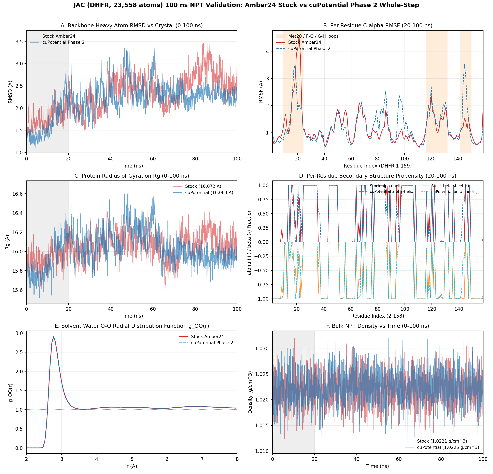

# amber-cupotential

Out-of-tree integration bringing **NVIDIA cuPotential** acceleration to **Amber 22 & Amber 24 `pmemd.cuda_SPFP`** (single-GPU PME SPFP engine), including **ff19SB CMAP** and **4/5-site Extra Point water models (OPC, TIP4P-Ew/2005, TIP5P)**.

> **中文说明**: 请参阅 [README_zh.md](README_zh.md)。

> [!IMPORTANT]
> **Compliance & Licensing Notice**
> - **Amber / PMEMD**: This repository contains **zero Amber source code or binaries**. Users must hold a valid Amber 22 or Amber 24 license and apply `scripts/patch_amber.py` to their local Amber source tree.
> - **NVIDIA cuPotential Runtime (`libcupo.so`)**: Proprietary binaries and C headers from [`NVIDIA/cuPotential`](https://github.com/NVIDIA/cuPotential) are **not bundled** here; `scripts/fetch_deps.sh` downloads them separately under the NVIDIA Software License Agreement for cuPotential Runtime (`LICENSE-cupo.txt`). Note in particular **Section 2.12** of `LICENSE-cupo.txt`, which restricts public disclosure of benchmarking, competitive analysis, or performance data obtained with the early-access cuPotential runtime without prior written permission from NVIDIA.

---

## Benchmarks & 100 ns Validation (NVIDIA RTX 4090)

Measured with `pmemd.cuda_SPFP` + `libcupo 0.3.5` (`chunk=8` CUDA Graph, steady-state `last_ns_day` over 50k steps for JAC and 20k steps for Factor IX):

### 1. Throughput on Standard Amber Systems (`ns/day`)

**JAC (DHFR in TIP3P water, 23,558 atoms)**

| Protocol | Stock Amber24 | Phase 1 (NB) | Stage 2A (+Bonded) | Phase 2 Whole-Step (Prolate) | Speedup | Phase 2 (Ewald) |
| --- | ---: | ---: | ---: | ---: | ---: | ---: |
| NVT Langevin (`cut=8 Å, dt=2 fs`) | `774.03` | `1220.24` | `2479.30` | **`3498.27`** | **`4.52x`** | `2771.79` |
| NVT Langevin (`cut=9 Å, dt=2 fs`) | `692.10` | `1239.60` | — | **`3196.58`** | **`4.62x`** | `2841.73` |
| NVT Middle (`cut=8 Å, dt=2 fs`) | `712.00` | `1086.33` | — | **`3093.88`** | **`4.35x`** | `2514.71` |
| NPT MC100 (`cut=8 Å, dt=2 fs`) | `745.94` | `1240.89` | — | **`2691.69`** | **`3.61x`** | `2260.47` |
| NPT MC100 (`cut=9 Å, dt=2 fs`) | `667.14` | `1228.85` | — | **`2661.10`** | **`3.99x`** | `2423.65` |
| NVT HMR Middle (`cut=9 Å, dt=4 fs`) | `1067.89` | `2156.98` | `3663.79` | **`5613.00`** | **`5.26x`** | `5089.65` |

**Factor IX (90,906 atoms)**

| Protocol | Stock Amber24 | Phase 1 (NB) | Stage 2A (+Bonded) | Phase 2 Whole-Step (Prolate) | Speedup | Phase 2 (Ewald) |
| --- | ---: | ---: | ---: | ---: | ---: | ---: |
| NVT Langevin (`cut=8 Å, dt=2 fs`) | `394.57` | `766.58` | `921.06` | **`1353.14`** | **`3.43x`** | `1061.88` |
| NVT Langevin (`cut=9 Å, dt=2 fs`) | `370.95` | `740.00` | — | **`1271.24`** | **`3.43x`** | `1044.28` |
| NVT Middle (`cut=8 Å, dt=2 fs`) | `352.86` | `629.18` | — | **`1299.41`** | **`3.68x`** | `1034.52` |
| NPT MC100 (`cut=8 Å, dt=2 fs`) | `375.94` | `664.96` | — | **`1097.18`** | **`2.92x`** | `910.16` |
| NPT MC100 (`cut=9 Å, dt=2 fs`) | `354.72` | `643.96` | — | **`1033.96`** | **`2.91x`** | `883.35` |
| NVT HMR Middle (`cut=9 Å, dt=4 fs`) | `596.30` | `1220.08` | `1412.56` | **`2414.06`** | **`4.05x`** | `1992.20` |

**`ff19SB + OPC` 4-Point Water & Amber 22 Parity (20k steps, `cut=8 Å, dt=2 fs`)**

| System & Engine | Protocol | Stock | Phase 2 Whole-Step (Prolate) | Speedup | Phase 2 (Ewald) | Speedup |
| --- | --- | ---: | ---: | ---: | ---: | ---: |
| **DHFR (`ff19SB + OPC`, 29,048 atoms) — Amber 24** | NVT Langevin | `595.29` | **`2644.61`** | **`4.44x`** | `2201.73` | `3.70x` |
| **DHFR (`ff19SB + OPC`, 29,048 atoms) — Amber 24** | NPT MC100 | `575.77` | **`2087.93`** | **`3.63x`** | `1823.20` | `3.17x` |
| **DHFR (`ff19SB + OPC`, 29,048 atoms) — Amber 22** | NVT Langevin | `621.18` | **`2602.17`** | **`4.19x`** | `2172.62` | `3.50x` |
| **DHFR (`ff19SB + OPC`, 29,048 atoms) — Amber 22** | NPT MC100 | `605.13` | **`2170.43`** | **`3.59x`** | `1885.87` | `3.12x` |
| **JAC (`ff14SB + TIP3P`, 23,558 atoms) — Amber 22** | NVT Langevin | `789.48` | **`3497.64`** | **`4.43x`** | `2760.01` | `3.50x` |

### 2. Long-Timescale 100 ns `JAC` NPT Structural & Thermodynamic Validation

Continuous **100.0 ns (`50,000,000` steps, `dt=2 fs`, `cut=8 Å`, `barostat=2, mcbarint=100`, `300 K`)** production trajectories comparing Phase 2 Whole-Step (`Prolate, chunk=8`) against Stock Amber24 `pmemd.cuda_SPFP`, analyzed over the steady-state window **`20–100 ns`** (1,600 frames):



| Observable (`20–100 ns` steady state) | Stock Amber24 | cuPotential Phase 2 | Agreement / Correlation |
| --- | ---: | ---: | --- |
| Sustained 100 ns wall-clock throughput | `747.58 ns/day` (`3.21 h`) | **`2,643.81 ns/day`** (`54.47 min`) | **`3.54x`** end-to-end speedup |
| Temperature (`K`) | `300.04 ± 1.99` | `300.04 ± 1.93` | `Δ = 0.00 K` |
| Bulk Density (`g/cm³`) | `1.0221 ± 0.0032` | `1.0225 ± 0.0031` | `+0.034%` |
| Backbone Heavy-Atom RMSD (`@N,CA,C,O`, `Å`) | `2.430 ± 0.365` (`SEM 0.139`) | `2.303 ± 0.285` (`SEM 0.056`) | Within `1×` block-SEM |
| Protein Radius of Gyration $R_g$ (`Å`) | `16.072 ± 0.138` | `16.064 ± 0.163` | `Δ = -0.008 Å` |
| Per-residue $C_\alpha$ RMSF (`159` res, `Å`) | mean `1.187 Å` | mean `1.243 Å` | Spearman $\rho = 0.833$, `MAE = 0.281 Å` |
| Ramachandran $\alpha$ / $\beta$ populations (`%`) | `40.27%` / `54.36%` | `40.74%` / `53.66%` | Per-res propensity $r = 0.946$ / $0.953$ |
| Backbone H-bonds per frame (`N–H···O=C`) | `69.13 ± 3.39` | `69.69 ± 3.20` | Occupancy Pearson $r = 0.831$ |
| Water O–O RDF $g_{\text{OO}}(r)$ 1st peak `(r₁, g₁)` | `(2.775 Å, 2.910)` | `(2.775 Å, 2.905)` | Full `0–8 Å` curve `RMSE = 0.00257` |

---

## Architecture Overview

Rather than relying on CUDA IPC or OpenMM wrappers, `amber-cupotential` bridges directly into Amber 22 / Amber 24's `pmemd.cuda_SPFP` GPU context (`gpuContext`) across three stages:

1. **Phase 1 — Nonbonded PME (`cupo_dspace` + `cupo_kspace`)**
   - Dynamically loads CUDA 13 runtime shared libraries (`libcudart.so.13`, `libnvrtc.so.13`, `libnvrtc-builtins.so.13*`, `libnvJitLink.so.13`, `libcufft.so.12`) and `libcupo.so` via `dlopen(..., RTLD_LOCAL | RTLD_DEEPBIND)`, allowing CUDA 11.8 (Amber 22) and CUDA 12.x (Amber 24) builds to execute CUDA 13 cuPotential kernels without symbol collisions.
   - Maps Amber's step-0 Hilbert image order and exclusion lists, supporting both **prolate** (default radial-truncated compact convolution) and **ewald** splitting (`AMBER_CUPO_SPLITTING=prolate|ewald`).
2. **Stage 2A — Fused FP32 Bonded, 1–4 Nonbonded & CMAP (`cupo_tuples` + `kCupoCmapForces_kernel`)**
   - Compiles harmonic bonds (including Urey–Bradley bonds), harmonic angles, periodic dihedrals, and non-excluded 1–4 Coulomb/LJ pairs into `cupo_tuples_*` batches whenever energy evaluation is not requested (`!needEnergy`).
   - Evaluates **ff19SB CMAP** bicubic Hermite spline forces natively via `kCupoCmapForces_kernel` in parallel on `misc_stream` (`BOND / ANGLE / DIHED / 1-4 / CMAP` single-step energies match Stock Amber to `0.0 kcal/mol`, CMAP atom force `RMSE = 9.43×10⁻⁴ kcal/(mol·Å)`).
3. **Stage 2B — Pure-FP32 `fltflt` GPU Integrators, Virtual Sites & Multi-Step CUDA Graph (`runmd.F90` + `cupo_integrator`)**
   - Keeps step-to-step positions and `fltflt` (double-float, rounded with PTX/device intrinsics safe under `-use_fast_math`) velocity accumulators resident on GPU.
   - Implements counter-based Philox 4x32-10 + Box–Muller thermostat noise (`CUPO_INTEG_MIDDLE`, `CUPO_INTEG_LEAPFROG_LANGEVIN`, `CUPO_INTEG_LEAPFROG_VERLET`), analytical closed-form `SETTLE` for rigid 3/4-site waters, 1..4-H star-`SHAKE`/`RATTLE`, `vlimit` clamping, and fixed-point net-force removal (excluding massless virtual sites).
   - Supports standard Extra Points (`EP11`, `EP12`, `EP21`, `EP22`, e.g., **OPC**, TIP4P*, TIP5P, lone pairs) via GPU-resident `kWholeOrientForces_kernel` force commutation and `double`-precision `kWholeLocalToGlobal_kernel` reconstruction (`|O–EP|` & bisector agreement `~5×10⁻¹⁵ Å` over 5k–10k NVE/NVT/NPT steps).
   - Captures and replays `chunk=8` (`AMBER_CUPO_CHUNK`) whole-step CUDA super-graphs across `runmd.F90` between output, trajectory, restart, and MC barostat intervals (`cupo_pmemd_try_run_batch`), with `CUDART_VERSION` guards supporting CUDA 11.8 and CUDA 12.x.

---

## Feature Support & Safe Fallback Matrix

Any simulation feature outside the supported path **automatically and safely falls back** to stock `pmemd.cuda_SPFP` without silent miscalculation.

| Feature / Mode | Acceleration Tier | Notes |
| --- | --- | --- |
| Explicit-solvent PME (`ff14SB` / `ff19SB` CMAP, TIP3P / **OPC** / TIP4P* / TIP5P), `ntt=3` Langevin | **Phase 2 Whole-Step (`chunk=8` Graph)** | Orthogonal & triclinic boxes; Lorentz–Berthelot LJ |
| Explicit-solvent PME, `ischeme=1, ithermostat=1` Middle (incl. HMR 4 fs) | **Phase 2 Whole-Step (`chunk=8` Graph)** | Supports 2 fs and 4 fs HMR (`parmed` HMassRepartition) |
| Explicit-solvent PME, `ntt=0` NVE | **Phase 2 Whole-Step (`chunk=8` Graph)** | Analytical SETTLE + star-SHAKE/RATTLE + EP force commutation |
| Explicit-solvent PME, `ntp>0, barostat=2` (Monte Carlo barostat) | **Phase 2 Whole-Step between MC trials** | Automatic box resize & `kspace_refresh_influence` on accepted moves |
| Single-step force/energy (`imin=0`, print/restart/MC trial steps) | **Phase 1 + Stage 2A** (Forces) / **Phase 1 + Amber Bonded** (Energy) | Bitwise consistent single-step fallback |
| `AMBER_USE_CUPO=0`, `imin=1` (minimization), `ntb=0` (implicit solvent), `ntt=1` (Berendsen T), `barostat=1` (Berendsen P), `ti_mode!=0`, `ntr=1`, NMR restraints, CHARMM impropers (`impDihedrals>0`), `EPCustomCount>0`, NBFIX, LJ 12-6-4, GaMD, NFE/PLUMED, constant pH/E | **Automatic Stock Fallback** | Handled natively by stock `pmemd.cuda_SPFP` |
| MPI multi-GPU (`pmemd.cuda_SPFP.MPI`), `pmemd.cuda_DPFP`, HIP/AMD | **Compiled as No-Op Stubs** | Preserves multi-target Amber CMake builds cleanly |

---

## 5-Minute Quickstart

### Prerequisites
- Licensed **Amber 22** or **Amber 24** source tree (`amber22_src` / `amber24_src`), CMake + CUDA Toolkit (11.8+ or 12.x) + GCC/GFortran
- Python 3.9+ (with `pip` for fetching CUDA 13 runtime wheels; `numpy` + `scipy` for running `tests/verify_integration.py`)
- NVIDIA GPU compute capability supported by `libcupo` (`sm_75`, `sm_80`, `sm_86`, `sm_89`, `sm_90`, `sm_100`, `sm_103`, `sm_120`; see upstream `runtime_build.json`)

### 1. Fetch NVIDIA cuPotential & Isolated CUDA 13 Runtime Libraries

```bash
./scripts/fetch_deps.sh --dest ./deps/cuPotential --tag v0.3.5
# Or verify an existing NVIDIA/cuPotential checkout + cuda13_lib directory:
./scripts/fetch_deps.sh --verify-only --dest /path/to/cuPotential
```

### 2. Inject Hooks into Amber 22 or Amber 24 Source Tree

```bash
# Dry-run anchor verification (writes nothing)
./scripts/patch_amber.py --amber-src /path/to/amber_src --check

# Apply hooks (creates .cupo.orig backups alongside the 4 modified files)
./scripts/patch_amber.py --amber-src /path/to/amber_src --apply

# Optional: inspect status or cleanly revert at any time
./scripts/patch_amber.py --amber-src /path/to/amber_src --status
./scripts/patch_amber.py --amber-src /path/to/amber_src --revert
```

> (`scripts/patch_amber24.py` remains as a backward-compatible alias to `scripts/patch_amber.py`.)

### 3. Build `pmemd.cuda_SPFP`

Pass `-DCUPO_ROOT=/abs/path/to/deps/cuPotential` (or rely on the default `${CMAKE_SOURCE_DIR}/cuPotential` if cloned inside `amber24_src`):

```bash
cd /path/to/amber24_src/build
cmake .. -DCUDA=TRUE -DCUPO_ROOT=/abs/path/to/deps/cuPotential   # (plus your existing Amber CMake flags)
cmake --build . --target pmemd.cuda_SPFP -j8
```

> **Note**: Both `libcupo.so` and `cuda13_lib` are resolved dynamically at runtime (`CUPO_LIB_PATH` / `CUPO_CUDA13_LIB_DIR` -> `CUPO_ROOT` -> `AMBERHOME` -> `CONDA_PREFIX` -> executable ancestor directories -> compile-time `CUPO_BUILD_ROOT`). You do **not** need `libcudart.so.13` in `LD_LIBRARY_PATH`; keep `LD_LIBRARY_PATH` clean when launching `pmemd.cuda_SPFP`.

### 4. Run Self-Contained Verification Suite

Without `--parm`/`--crd`, the test script automatically synthesizes a 2,114-atom periodic *n*-butane + 700 TIP3P water system, minimizes and equilibrates it, and verifies Stage 2A force/energy accuracy, Stage 2B NVE energy conservation & H-bond constraints, `chunk=8` vs `chunk=1` vs Eager CUDA Graph bitwise equivalence, NVT/NPT ensembles, and automatic fallbacks:

```bash
./tests/verify_integration.py --pmemd /path/to/amber24_src/build/src/pmemd/src/pmemd.cuda_SPFP
```

You can also validate directly against your own biomolecular system:

```bash
./tests/verify_integration.py \
  --pmemd /path/to/pmemd.cuda_SPFP \
  --parm system.parm7 --crd system.rst7 --hmr-parm system_hmr.parm7
```

### 5. Local Throughput Evaluation (Optional)

```bash
./benchmarks/run_benchmark.py \
  --pmemd /path/to/pmemd.cuda_SPFP \
  --parm system.parm7 --crd system.rst7 --hmr-parm system_hmr.parm7
```

---

## Runtime Environment Variables

| Variable | Default | Description |
| --- | --- | --- |
| `AMBER_USE_CUPO` | `1` | Master toggle (`0` disables `cuPotential` and runs stock Amber) |
| `AMBER_CUPO_SPLITTING` | `prolate` | PME electrostatics splitting (`prolate` or `ewald`) |
| `AMBER_CUPO_BONDED` | `1` | Enable Stage 2A `cupo_tuples` FP32 bonded + 1–4 forces (`0` uses Amber bonded) |
| `AMBER_CUPO_WHOLE_STEP` | `1` | Enable Stage 2B whole-step GPU integration & `runmd.F90` batching |
| `AMBER_CUPO_CHUNK` | `8` | Steps per super-graph in whole-step mode (clamped to `1..64`) |
| `AMBER_CUPO_GRAPH` / `CUPO_PLUGIN_CUDA_GRAPH` | `1` | Enable (`1`) or disable (`0`) CUDA Graph capture/replay |
| `CUPO_ROOT` | — | Root directory containing `build/libcupo.so` and `build/cuda13_lib/` |
| `CUPO_LIB_PATH` | auto | Explicit path override for `libcupo.so` |
| `CUPO_CUDA13_LIB_DIR` | auto | Explicit directory override containing CUDA 13 shared libraries |
| `AMBER_CUPO_BOX_SAFETY` | `1.0` (NVT) / `1.15` (NPT) | Prolate/cell-list box growth safety factor |

---

## Known Diagnostics Caveats

- Avoid profiling `AMBER_USE_CUPO=1` with `nsys profile --trace=cuda` (CUPTI hooking across `RTLD_DEEPBIND`-loaded `libcudart.so.13` can terminate with `SIGSEGV`). Use `--trace=osrt,nvtx` or built-in Amber timing logs instead.
- If another CUDA 13 `LD_LIBRARY_PATH` is exported globally before launching `pmemd.cuda_SPFP`, unset `LD_LIBRARY_PATH` (or wrap the binary) so Amber links against its own CUDA 12 libraries while `cupo_nonbond.cu` isolates CUDA 13 inside `RTLD_LOCAL | RTLD_DEEPBIND`.

---

## Repository Contents

- `src/` — Standalone integration sources (`Apache-2.0`, except `cupo_fltflt.cuh` under `BSD-3-Clause`):
  - `cupo_fltflt.cuh`, `cupo_integrator.h`, `cupo_integrator.cu`, `cupo_nonbond.h`, `cupo_nonbond.cu`
- `scripts/fetch_deps.sh` — Downloads official `NVIDIA/cuPotential` + PyPI CUDA 13 runtime shared libraries
- `scripts/patch_amber.py` — Anchor-based injector/reverter for Amber 22 & Amber 24 `src/pmemd` (`patch_amber24.py` kept as alias)
- `tests/verify_integration.py` — End-to-end accuracy, conservation, constraint/EP, graph equivalence, and fallback suite
- `benchmarks/run_benchmark.py` — Local throughput comparison harness
