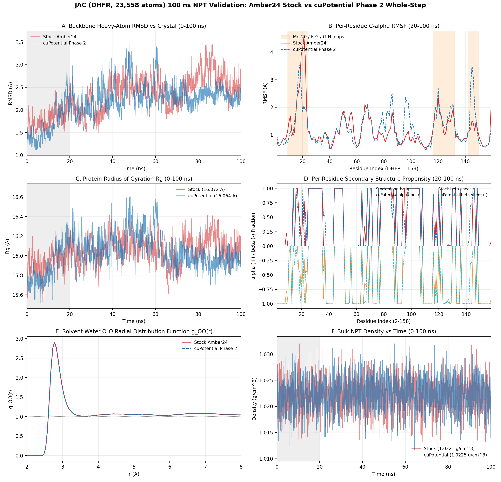

# amber-cupotential

为 **Amber 22 & Amber 24 `pmemd.cuda_SPFP`**（单卡 PME SPFP 引擎）接入 **NVIDIA cuPotential** 的独立开源补丁仓库，完整支持 **ff19SB CMAP** 与 **4/5 点虚拟位点水模型（OPC、TIP4P-Ew/2005、TIP5P）**。

> **English Documentation**: See [README.md](README.md)。

> [!IMPORTANT]
> **合规与许可证提示**
> - **Amber / PMEMD**：本仓库**不包含任何 Amber 源码或二进制文件**。使用者须持有合法的 Amber 22 或 Amber 24 授权，并在本地运行 `scripts/patch_amber.py` 将钩子注入自己的 Amber 源码树。
> - **NVIDIA cuPotential 运行时（`libcupo.so`）**：本仓库**不捆绑**来自 [`NVIDIA/cuPotential`](https://github.com/NVIDIA/cuPotential) 的专有动态库及 C 头文件；`scripts/fetch_deps.sh` 会在本地按 NVIDIA cuPotential Runtime 许可协议（`LICENSE-cupo.txt`）单独拉取。特别注意该协议 **第 2.12 条**：在 Early-Access 阶段，未经 NVIDIA 事先书面许可，不得对外公开发布基于 `libcupo` 测得的性能对比或 Benchmark 数据。

---

## 实测性能与 100 ns 宏观性质验证（NVIDIA RTX 4090）

在 RTX 4090 上使用 `pmemd.cuda_SPFP` + `libcupo 0.3.5`（`chunk=8` CUDA Graph）实测稳态吞吐量（`last_ns_day`；JAC 为 50k 步、Factor IX 为 20k 步）：

### 1. 标准生物分子体系稳态吞吐量对比（`ns/day`）

**JAC（DHFR + TIP3P 水，23,558 原子）**

| 模拟协议 | 原生 Amber24 | Phase 1 (NB) | Stage 2A (+Bonded) | Phase 2 全步加速 (Prolate) | 加速比 | Phase 2 (Ewald) |
| --- | ---: | ---: | ---: | ---: | ---: | ---: |
| NVT Langevin (`cut=8 Å, dt=2 fs`) | `774.03` | `1220.24` | `2479.30` | **`3498.27`** | **`4.52x`** | `2771.79` |
| NVT Langevin (`cut=9 Å, dt=2 fs`) | `692.10` | `1239.60` | — | **`3196.58`** | **`4.62x`** | `2841.73` |
| NVT Middle (`cut=8 Å, dt=2 fs`) | `712.00` | `1086.33` | — | **`3093.88`** | **`4.35x`** | `2514.71` |
| NPT MC100 (`cut=8 Å, dt=2 fs`) | `745.94` | `1240.89` | — | **`2691.69`** | **`3.61x`** | `2260.47` |
| NPT MC100 (`cut=9 Å, dt=2 fs`) | `667.14` | `1228.85` | — | **`2661.10`** | **`3.99x`** | `2423.65` |
| NVT HMR Middle (`cut=9 Å, dt=4 fs`) | `1067.89` | `2156.98` | `3663.79` | **`5613.00`** | **`5.26x`** | `5089.65` |

**Factor IX（90,906 原子）**

| 模拟协议 | 原生 Amber24 | Phase 1 (NB) | Stage 2A (+Bonded) | Phase 2 全步加速 (Prolate) | 加速比 | Phase 2 (Ewald) |
| --- | ---: | ---: | ---: | ---: | ---: | ---: |
| NVT Langevin (`cut=8 Å, dt=2 fs`) | `394.57` | `766.58` | `921.06` | **`1353.14`** | **`3.43x`** | `1061.88` |
| NVT Langevin (`cut=9 Å, dt=2 fs`) | `370.95` | `740.00` | — | **`1271.24`** | **`3.43x`** | `1044.28` |
| NVT Middle (`cut=8 Å, dt=2 fs`) | `352.86` | `629.18` | — | **`1299.41`** | **`3.68x`** | `1034.52` |
| NPT MC100 (`cut=8 Å, dt=2 fs`) | `375.94` | `664.96` | — | **`1097.18`** | **`2.92x`** | `910.16` |
| NPT MC100 (`cut=9 Å, dt=2 fs`) | `354.72` | `643.96` | — | **`1033.96`** | **`2.91x`** | `883.35` |
| NVT HMR Middle (`cut=9 Å, dt=4 fs`) | `596.30` | `1220.08` | `1412.56` | **`2414.06`** | **`4.05x`** | `1992.20` |

**`ff19SB + OPC` 4 点水体系与 Amber 22 同卡对比（20k 步，`cut=8 Å, dt=2 fs`）**

| 体系与引擎版本 | 模拟协议 | 原生引擎 | Phase 2 全步 (Prolate) | 加速比 | Phase 2 (Ewald) | 加速比 |
| --- | --- | ---: | ---: | ---: | ---: | ---: |
| **DHFR (`ff19SB + OPC`, 29,048 原子) — Amber 24** | NVT Langevin | `595.29` | **`2644.61`** | **`4.44x`** | `2201.73` | `3.70x` |
| **DHFR (`ff19SB + OPC`, 29,048 原子) — Amber 24** | NPT MC100 | `575.77` | **`2087.93`** | **`3.63x`** | `1823.20` | `3.17x` |
| **DHFR (`ff19SB + OPC`, 29,048 原子) — Amber 22** | NVT Langevin | `621.18` | **`2602.17`** | **`4.19x`** | `2172.62` | `3.50x` |
| **DHFR (`ff19SB + OPC`, 29,048 原子) — Amber 22** | NPT MC100 | `605.13` | **`2170.43`** | **`3.59x`** | `1885.87` | `3.12x` |
| **JAC (`ff14SB + TIP3P`, 23,558 原子) — Amber 22** | NVT Langevin | `789.48` | **`3497.64`** | **`4.43x`** | `2760.01` | `3.50x` |

### 2. JAC 体系 100 ns NPT 宏观热力学与蛋白质/溶剂结构验证

对 Phase 2 全步加速（`Prolate, chunk=8`）与原生 Amber24 `pmemd.cuda_SPFP` 分别运行连续 **100.0 ns NPT 生产轨迹（5,000 万步，`dt=2 fs`，`cut=8 Å`，`barostat=2, mcbarint=100`，`300 K`）**，取 **`20–100 ns`** 平衡窗口（1,600 帧）对比：



| 统计观测量（`20–100 ns` 平衡态） | 原生 Amber24 | cuPotential Phase 2 | 一致性 / 相关性 |
| --- | ---: | ---: | --- |
| 100 ns 全程真实墙钟吞吐 | `747.58 ns/day` (`3.21 h`) | **`2,643.81 ns/day`** (`54.47 min`) | 端到端真实加速 **`3.54x`** |
| 温度 $T$ (`K`) | `300.04 ± 1.99` | `300.04 ± 1.93` | `Δ = 0.00 K` |
| 体系密度 $\rho$ (`g/cm³`) | `1.0221 ± 0.0032` | `1.0225 ± 0.0031` | `+0.034%` |
| 主链重原子 RMSD (`@N,CA,C,O`, `Å`) | `2.430 ± 0.365` (`SEM 0.139`) | `2.303 ± 0.285` (`SEM 0.056`) | 在分块误差带内一致 |
| 蛋白回转半径 $R_g$ (`Å`) | `16.072 ± 0.138` | `16.064 ± 0.163` | `Δ = -0.008 Å` |
| 逐残基 $C_\alpha$ RMSF (`159` 残基, `Å`) | 均值 `1.187 Å` | 均值 `1.243 Å` | Spearman $\rho = 0.833$，`MAE = 0.281 Å` |
| Ramachandran $\alpha$ / $\beta$ 占比 | `40.27%` / `54.36%` | `40.74%` / `53.66%` | 逐残基倾向 $r = 0.946$ / $0.953$ |
| 每帧主链氢键数 (`N–H···O=C`) | `69.13 ± 3.39` | `69.69 ± 3.20` | 占据率 Pearson $r = 0.831$ |
| 水氧 RDF $g_{\text{OO}}(r)$ 第一峰 `(r₁, g₁)` | `(2.775 Å, 2.910)` | `(2.775 Å, 2.905)` | `0–8 Å` 全曲线 `RMSE = 0.00257` |

---

## 架构概览

本集成直接在 Amber 22 / Amber 24 `pmemd.cuda_SPFP` 的 GPU 上下文（`gpuContext`）内部完成对接，不经过 OpenMM 包装层或跨进程 IPC，包含三个演进层级：

1. **Phase 1 — 非键 PME 加速（`cupo_dspace` + `cupo_kspace`）**
   - 通过 `dlopen(..., RTLD_LOCAL | RTLD_DEEPBIND)` 在隔离命名空间中按需加载 CUDA 13 运行时动态库（`libcudart.so.13`、`libnvrtc.so.13`、`libnvrtc-builtins.so.13*`、`libnvJitLink.so.13`、`libcufft.so.12`）与 `libcupo.so`，使 CUDA 11.8（Amber 22）或 CUDA 12.x（Amber 24）编译的二进制可安全调用 CUDA 13 版 `libcupo.so`。
   - 复用第 0 步 Hilbert 空间排序与排除表，默认采用径向截断紧致卷积 **prolate** 分裂，也可切换至标准 **ewald**（`AMBER_CUPO_SPLITTING=prolate|ewald`）。
2. **Stage 2A — 融合 FP32 键合、1–4 非键与 CMAP（`cupo_tuples` + `kCupoCmapForces_kernel`）**
   - 在仅需受力计算的常规 MD 步（`!needEnergy`）将谐振键/Urey–Bradley 键、谐振键角、周期二面角与 1–4 Coulomb/LJ 配对下沉至 `cupo_tuples_*` 批量执行。
   - 在 `misc_stream` 上通过自研 `kCupoCmapForces_kernel` 并行计算 **ff19SB CMAP** 二维双三次 Hermite 样条力（单步分项能量差 `0.0 kcal/mol`，CMAP 原子受力 `RMSE = 9.43×10⁻⁴ kcal/(mol·Å)`）。
3. **Stage 2B — 纯 FP32 `fltflt` GPU 积分器、虚拟位点与多步超级 CUDA Graph（`runmd.F90` + `cupo_integrator`）**
   - 坐标与 `fltflt`（双浮点，在 `-use_fast_math` 下显式使用 PTX/device 舍入原语）速度全程常驻 GPU。
   - 内置基于计数器的 Philox 4x32-10 + Box–Muller 热浴随机数、`CUPO_INTEG_MIDDLE` / `CUPO_INTEG_LEAPFROG_LANGEVIN` / `CUPO_INTEG_LEAPFROG_VERLET` 积分器、闭合解析水分子 `SETTLE`、1–4 氢原子星形 `SHAKE`/`RATTLE`、`vlimit` 限速与定点净力归零（自动跳过零质量虚拟位点）。
   - 支持标准 Extra Points（`EP11`、`EP12`、`EP21`、`EP22`，涵盖 **OPC**、TIP4P*、TIP5P 与孤对电子）：GPU 内核 `kWholeOrientForces_kernel` 自动将虚拟位点受力投影至母原子/参考架，约束积分后通过双精度 `kWholeLocalToGlobal_kernel` 重构坐标（5k–10k 步 NVE/NVT/NPT 实测 `O–EP` 距与角平分线共线误差 **`~5×10⁻¹⁵ Å`**）。
   - 通过 `runmd.F90` 批量入口在输出、轨迹、重启及 MC 恒压试探步之间执行 `chunk=8`（`AMBER_CUPO_CHUNK`）全步 CUDA 超级图捕获与重放，并按 `CUDART_VERSION` 兼容 CUDA 11.8 与 12.x。

---

## 功能支持与安全回退矩阵

任何超出支持范围的模拟选项都会**自动安全回退到原生 `pmemd.cuda_SPFP`**，绝不会静默产生错误结果。

| 功能 / 系综模式 | 加速路径 | 说明 |
| --- | --- | --- |
| 显式溶剂 PME（`ff14SB` / `ff19SB` CMAP，TIP3P / **OPC** / TIP4P* / TIP5P）、`ntt=3` Langevin | **Phase 2 全步加速（`chunk=8` Graph）** | 正交盒与三斜盒；Lorentz–Berthelot 组合规则 |
| 显式溶剂 PME、`ischeme=1, ithermostat=1` Middle（含 4 fs HMR） | **Phase 2 全步加速（`chunk=8` Graph）** | 支持 2 fs 与 4 fs 氢质量重分配（HMR） |
| 显式溶剂 PME、`ntt=0` NVE | **Phase 2 全步加速（`chunk=8` Graph）** | 解析 SETTLE + 星形 SHAKE/RATTLE + EP 力矩重分配 |
| 显式溶剂 PME、`ntp>0, barostat=2`（Monte Carlo 恒压器） | **试探步间全步加速 + 单步 MC 试探** | 接受体积变化后自动刷新盒长与 `kspace` 影响函数 |
| 能量打印步 / 重启步 / MC 试探步 | **Phase 1 + Stage 2A**（纯力）或 **Phase 1 + Amber Bonded**（能量） | 保持能量分项报告完整一致 |
| `AMBER_USE_CUPO=0`、能量最小化（`imin=1`）、隐式溶剂（`ntb=0`）、Berendsen 恒温/恒压（`ntt=1` / `barostat=1`）、TI（`ti_mode!=0`）、位置约束（`ntr=1`）、NMR 约束、CHARMM Improper（`impDihedrals>0`）、自定义虚位点（`EPCustomCount>0`）、NBFIX、LJ 12-6-4、GaMD、NFE/PLUMED、恒 pH/E | **自动安全回退** | 由原生 `pmemd.cuda_SPFP` 完整接管 |
| 多卡 MPI（`pmemd.cuda_SPFP.MPI`）、`pmemd.cuda_DPFP`、HIP/AMD | **自动编译为空桩（Stub）** | 不影响 Amber 多精度及 MPI 目标的正常编译 |

---

## 五分钟快速上手

### 环境要求
- 已获得授权的 **Amber 22** 或 **Amber 24** 源码目录（`amber22_src` / `amber24_src`）、CMake、CUDA Toolkit（11.8+ 或 12.x）及 GCC/GFortran
- Python 3.9+（安装 CUDA 13 wheel 依赖需 `pip`；运行校验脚本需 `numpy` 和 `scipy`）
- 受 `libcupo` 支持架构的 NVIDIA GPU（`sm_75`, `sm_80`, `sm_86`, `sm_89`, `sm_90`, `sm_100`, `sm_103`, `sm_120`）

### 1. 拉取 NVIDIA cuPotential 与独立 CUDA 13 运行时库

```bash
./scripts/fetch_deps.sh --dest ./deps/cuPotential --tag v0.3.5
# 若本地已有 cuPotential 与 cuda13_lib 目录，可直接校验：
./scripts/fetch_deps.sh --verify-only --dest /path/to/cuPotential
```

### 2. 将钩子注入 Amber 22 或 Amber 24 源码

```bash
# 预演检查（仅在内存中校验锚点，不修改文件）
./scripts/patch_amber.py --amber-src /path/to/amber_src --check

# 应用补丁（自动生成 .cupo.orig 备份并拷贝 src/cupo_* 文件）
./scripts/patch_amber.py --amber-src /path/to/amber_src --apply

# 可随时查看状态或一键无损还原：
./scripts/patch_amber.py --amber-src /path/to/amber_src --status
./scripts/patch_amber.py --amber-src /path/to/amber_src --revert
```

> （保留 `scripts/patch_amber24.py` 作为向后兼容入口。）

### 3. 编译 `pmemd.cuda_SPFP`

通过 `-DCUPO_ROOT=/abs/path/to/deps/cuPotential` 指定依赖根目录（若放置在 `${CMAKE_SOURCE_DIR}/cuPotential` 则自动发现）：

```bash
cd /path/to/amber24_src/build
cmake .. -DCUDA=TRUE -DCUPO_ROOT=/path/to/deps/cuPotential   # 可叠加你原有的 Amber CMake 参数
cmake --build . --target pmemd.cuda_SPFP -j8
```

> **提示**：运行时会依次从环境变量 `CUPO_LIB_PATH` / `CUPO_CUDA13_LIB_DIR`、`CUPO_ROOT`、`AMBERHOME`、`CONDA_PREFIX`、可执行文件上级目录以及编译期 `CUPO_BUILD_ROOT` 自动定位 `libcupo.so` 与 `cuda13_lib`。**不要**把 CUDA 13 路径全局写入 `LD_LIBRARY_PATH`，以保持主程序与隔离运行时各自链接正确版本的 CUDA 库。

### 4. 运行自包含回归验证套件

不传入 `--parm`/`--crd` 时，脚本会在临时目录中自动合成一个周期性 **正丁烷 + 700 个 TIP3P 水分子（共 2,114 原子）** 标准测试体系，完成最小化与升温平衡后，依次校验 Stage 2A 力/能量精度、Stage 2B NVE 能量守恒与 SETTLE/SHAKE 键长约束、`chunk=8` / `chunk=1` / Eager 位级一致性、NVT/NPT 系综以及自动回退路径：

```bash
./tests/verify_integration.py --pmemd /path/to/amber24_src/build/src/pmemd/src/pmemd.cuda_SPFP
```

也可直接指定你自己的生物大分子体系验证：

```bash
./tests/verify_integration.py \
  --pmemd /path/to/pmemd.cuda_SPFP \
  --parm system.parm7 --crd system.rst7 --hmr-parm system_hmr.parm7
```

### 5. 本地速度基准测试（可选）

```bash
./benchmarks/run_benchmark.py \
  --pmemd /path/to/pmemd.cuda_SPFP \
  --parm system.parm7 --crd system.rst7 --hmr-parm system_hmr.parm7
```

---

## 运行时环境变量一览

| 变量名 | 默认值 | 说明 |
| --- | --- | --- |
| `AMBER_USE_CUPO` | `1` | 总开关（设为 `0` 时完全回退原生 Amber） |
| `AMBER_CUPO_SPLITTING` | `prolate` | PME 静电分裂方案（`prolate` 或 `ewald`） |
| `AMBER_CUPO_BONDED` | `1` | 启用 Stage 2A `cupo_tuples` FP32 键合与 1–4 非键（设为 `0` 回退原生键合核） |
| `AMBER_CUPO_WHOLE_STEP` | `1` | 启用 Stage 2B GPU 全步积分与 `runmd.F90` 批处理 |
| `AMBER_CUPO_CHUNK` | `8` | 每个超级图捕获的 MD 步数（限制在 `1..64`） |
| `AMBER_CUPO_GRAPH` / `CUPO_PLUGIN_CUDA_GRAPH` | `1` | CUDA Graph 捕获与重放开关（设为 `0` 使用 Eager 模式） |
| `CUPO_ROOT` | — | 包含 `build/libcupo.so` 与 `build/cuda13_lib/` 的根目录 |
| `CUPO_LIB_PATH` | 自动发现 | 显式覆盖 `libcupo.so` 文件路径 |
| `CUPO_CUDA13_LIB_DIR` | 自动发现 | 显式覆盖 CUDA 13 运行时库目录路径 |
| `AMBER_CUPO_BOX_SAFETY` | `1.0` (NVT) / `1.15` (NPT) | Prolate / Cell-List 盒子膨胀安全系数 |

---

## 已知注意事项

- 勿对 `AMBER_USE_CUPO=1` 使用 `nsys profile --trace=cuda`（CUPTI 对 `RTLD_DEEPBIND` 加载的 `libcudart.so.13` 插桩会触发 `SIGSEGV`）。如需性能分析，请使用 `--trace=osrt,nvtx` 或 `mdout` 内置计时统计。

---

## 仓库目录结构

- `src/` — 独立集成源码（除 `cupo_fltflt.cuh` 为 `BSD-3-Clause` 外，其余采用 `Apache-2.0`）：
  - `cupo_fltflt.cuh`、`cupo_integrator.h`、`cupo_integrator.cu`、`cupo_nonbond.h`、`cupo_nonbond.cu`
- `scripts/fetch_deps.sh` — 从官方仓库和 PyPI 拉取并校验 `libcupo.so` 及 CUDA 13 隔离依赖库
- `scripts/patch_amber.py` — 支持 Amber 22 & Amber 24 的锚点式补丁注入与还原工具（保留 `patch_amber24.py` 别名）
- `tests/verify_integration.py` — 精度、守恒性、约束/虚拟位点、CUDA Graph 等价性与回退全套验证脚本
- `benchmarks/run_benchmark.py` — 本地吞吐量评测脚本
